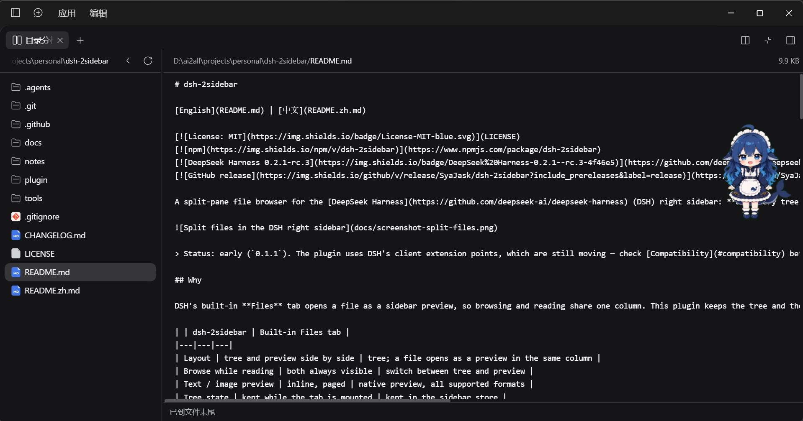

# dsh-2sidebar

[English](README.md) | [中文](README.zh.md)

[](LICENSE)
[](https://www.npmjs.com/package/dsh-2sidebar)
[](https://github.com/deepseek-ai/deepseek-harness)
[](https://github.com/SyaJask/dsh-2sidebar/releases)

A split-pane file browser for the [DeepSeek Harness](https://github.com/deepseek-ai/deepseek-harness) (DSH) right sidebar: **directory tree on the left, the selected file on the right** — both visible at once, so switching files never moves the tree.



> Status: early (`0.1.2`). The plugin uses DSH's client extension points, which are still moving — check [Compatibility](#compatibility) before upgrading DSH.

## Why

DSH's built-in **Files** tab opens a file as a sidebar preview, so browsing and reading share one column. This plugin keeps the tree and the preview side by side in the same tab: click a file, the right pane switches, the tree stays exactly where it was.

| | dsh-2sidebar | Built-in Files tab |
|---|---|---|
| Layout | tree and preview side by side | tree; a file opens as a preview in the same column |
| Browse while reading | both always visible | switch between tree and preview |
| Text / image preview | inline, paged | native preview, all supported formats |
| Tree state | kept while the tab is mounted | kept in the sidebar store |
| Open shortcut | header button / guide card | `Mod+P` |

Both can be installed and used at the same time.

## Features

- **Split view** with a draggable divider (20%–70%); the ratio and the collapsed-tree state are remembered in this browser's localStorage (windows at the same origin share them).
- **Lazy directory tree** rooted at the session's workspace: directories load when expanded, `Reload` refreshes the root and expanded levels, and empty and truncated states are reported inline (a refresh that fails after a successful load keeps the last listing).
- **Text preview** paged at 2,000 lines with `Load more` / `End of file`, plus a byte counter.
- **Image preview** for `png`, `jpg`, `jpeg`, `gif`, `webp`, `bmp`, `ico`, `avif` and `svg`.
- **Collapse the tree** to a single preview column, and restore it without losing the selected file.
- **Two entry points**: the split icon in the session header (next to the native sidebar toggle), and the guide card on the right sidebar start page; once opened it is an ordinary right-sidebar tab.
- **Theme-aware styles**, English and Chinese UI.
- **Read-only and offline**: no network calls, no host-side business code, and no npm runtime dependencies; rendering uses DSH's shell baseline client primitives (see [Compatibility](#compatibility)). File access goes through the host's `workspaceFiles` service, under the same caps as the built-in features.

## Install

### Requirements

- DSH Desktop with a managed profile (tested on `0.2.1-rc.5`; see [Compatibility](#compatibility)).
- The right sidebar and the client plugin manager (both ship with DSH).

### From npm (recommended)

```powershell
dsh plugin --profile desktop add dsh-2sidebar
```

Or in the DSH Web GUI: **Plugins** → **Add plugin** → enter `dsh-2sidebar` → **Install**, then switch the **Split files** bundle on.

`desktop` is the default DSH Desktop profile; replace it if your installation uses another name. No restart is needed: the host reloads the profile in place (HMR). If a tab that is already mounted keeps the old component, press `Ctrl+Shift+R`.

### From a clone (development)

```powershell
git clone https://github.com/SyaJask/dsh-2sidebar.git
dsh plugin --profile desktop add "link:C:/src/dsh-2sidebar"
```

You can also point the GUI's **Add plugin** dialog at the absolute path of the repository root.

### Open it

- Click the **split icon** in the session header, next to the native "open/collapse right sidebar" button.
- Or open the right sidebar start page and pick the **Split files** card.
- The plugin is a normal sidebar tab: dock, split and fullscreen behave exactly like other tabs.

### Uninstall

- GUI: **Plugins** → the **Split files** bundle → **Remove**.
- CLI:

```powershell
dsh plugin --profile desktop remove dsh-2sidebar
```

## Usage

- Click a directory to expand or collapse it; expanding re-reads that directory.
- Click a file to load it into the right pane; the tree keeps its scroll position and expansion state.
- Drag the divider to change the split ratio; the ratio is saved when you release.
- **Reload** refreshes the root and every expanded directory.
- **Hide tree** collapses the left pane; the preview keeps the selected file.
- For text, **Load more** appends the next 2,000-line page; the footer shows `End of file` at the end.
- PDF/Office/HTML files are intentionally not rendered inline — open them in DSH's native preview instead.

## Compatibility

- **Tested**: DSH Desktop `0.2.1-rc.5` on Windows (the client APIs used here were re-checked against `0.2.1-rc.5`; `0.2.1-rc.3` was the previously tested version).
- **Expected to work**: other DSH Desktop versions with the same client services (`slots`, `sessions`, `locale`, `sidebarRightTabs`, `sidebarRight`, `remote`, `remote.workspaceFiles`) and the shell's baseline client primitives (`@deepseek-ai/dsh-client-ui-primitives`), and the macOS/Linux builds; the bundle itself is platform-independent.
- DSH is in developer preview and its extension APIs can change without notice. If the plugin stops loading after a DSH upgrade, open an issue with the DSH version and the browser console error.

## How it works

The package is a **client-only bundle**:

- `index.js` is an empty host half; all rendering lives in the browser.
- The client registers a sidebar tab **type** (`ctx.sidebarRightTabs`), its **body** through the `sidebar.right.pane.tab` slot, its **title** through `sidebar.right.pane.tab.title`, a header button through `conversation.session.header.utilities`, and its own locale dictionaries (`zh`, `en`).
- Directory listings and file pages come from the host's existing `ctx.remote.workspaceFiles` (`list` / `read` / `readBytes`); the workspace root comes from `ctx.sessions.list`. The plugin adds no host routes and no permissions of its own.
- `cordis.patch.yml` inserts one profile row; `keepMounted: true` keeps the body alive across tab switches, so the tree state survives.

## FAQ

**The plugin does not show up.**
Check that the installed DSH version matches the tested one, that the bundle is enabled in **Plugins**, and look for `[split-files]` messages in the DevTools console. If the bundle fails to load, the rest of DSH keeps working — the tab and header button simply do not appear.

**It says "This session has no workspace directory".**
The tree is rooted at the session's working directory; sessions without one have nothing to browse. Open a session that has a workspace.

**A file says it is too large or binary.**
Text is read as line pages under the host's `maxBytes` (2 MiB per page) and `maxLines` (5,000) caps; images are read as complete files under `maxFileBytes` (32 MiB by default). A page whose lines together exceed 2 MiB fails as "too large" even when no single line is oversized; a single line above the cap cannot be previewed as text either.

**Can I open PDF, Office or HTML files in the right pane?**
Not inline. Use DSH's native preview tab for those formats; this plugin focuses on code, configuration and images.

**Does the plugin read or send my files anywhere?**
It is read-only: it calls the host's workspace file service, which applies the same workspace scoping and limits as the built-in UI. The bundle makes no network requests and has no telemetry.

**Where are the split ratio and tree state stored?**
In `localStorage` (`dsh-2sidebar.ratio`, `dsh-2sidebar.tree-hidden`). Clear site data or those two keys to reset them. The pre-rename `dsh-split-files.*` keys are still read as a fallback when the new key is absent.

**Why are there two file tabs?**
The built-in **Files** tab is for opening files into native previews; this plugin is for reading a tree and a file at the same time. They do not conflict.

## Roadmap

- File search/filter and a hidden-file toggle.
- Auto-refresh through the workspace file change feed.
- "Open in native preview" for PDF/Office/HTML.
- Keyboard navigation and a configurable shortcut.
- Automated tests and CI.
- More UI languages.

## Development

There is no build step: `client.js` is the deployed client bundle and `index.js` is the empty host half.

```powershell
node --check client.js      # syntax
```

To iterate, install from a clone with the `link:` spec and edit `client.js`; an npm installation is a copied package and does not follow source edits. The host reloads the profile on change.

Pull requests and issues are welcome. For anything that touches DSH's internal client APIs, please include the tested DSH version.

## Repository layout

| Path | What |
|---|---|
| `package.json`, `index.js`, `client.js`, `cordis.patch.yml`, `locale/`, `icon.svg` | The plugin bundle — the npm package and the install target |
| `docs/` | Screenshot and release notes |
| `.github/workflows/` | CI: npm publishing with provenance |

## License

[MIT](LICENSE) © 2026 SyaJask
