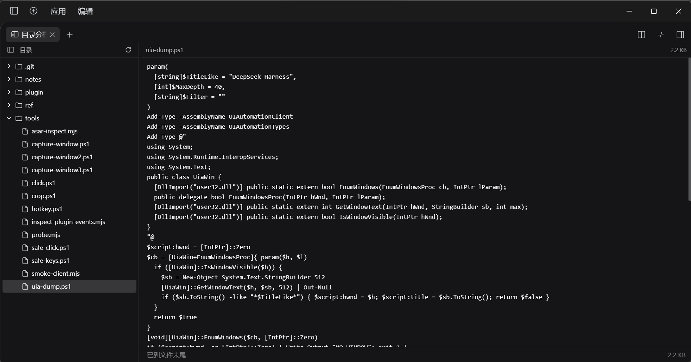

# dsh-2sidebar

[English](README.md) | [中文](README.zh.md)

[](LICENSE)
[](https://www.npmjs.com/package/dsh-2sidebar)
[](https://github.com/deepseek-ai/deepseek-harness)
[](https://github.com/SyaJask/dsh-2sidebar/releases)

给 [DeepSeek Harness](https://github.com/deepseek-ai/deepseek-harness)（DSH）右侧栏用的「目录分栏」插件：**左边目录树、右边文件内容**，两栏同时可见，切换文件时目录树原地不动。



> 状态：早期版本（`0.1.1`）。插件依赖 DSH 的客户端扩展点，这些接口仍在演进；升级 DSH 前请先看[兼容性](#兼容性)。

## 为什么做这个

DSH 自带的 **Files** 页签是把文件作为预览打开在侧栏里，浏览目录和阅读文件共用同一列。本插件把目录树和预览放进**同一个页签的两栏**：点文件，右栏切换，左树完全不动。

| | dsh-2sidebar | 自带 Files 页签 |
|---|---|---|
| 布局 | 目录树与预览并排 | 目录树；文件以预览形式占用同一列 |
| 边看目录边读文件 | 两栏始终可见 | 在目录与预览之间切换 |
| 文本 / 图片预览 | 内联、分页 | 原生预览，支持全部格式 |
| 树的展开状态 | 页签挂载期间保持 | 由侧栏 store 保持 |
| 打开方式 | 标题栏按钮 / 引导卡片 | `Mod+P` |

两者可以同时安装、同时使用。

## 功能

- **分栏视图**：中间分隔条可拖动（20%–70%），比例与「收起目录」状态按窗口记忆。
- **懒加载目录树**：以会话工作区为根，展开时才读取该层；「重新读取」刷新根目录和所有已展开层；空目录、被截断、读取失败都有行内提示。
- **文本预览**：每页 2,000 行，可「加载更多」，到底显示「已到文件末尾」，并显示文件大小。
- **图片预览**：支持 `png`、`jpg`、`jpeg`、`gif`、`webp`、`bmp`、`ico`、`avif` 和 `svg`。
- **收起目录**：折叠成单栏预览，展开后仍保留当前选中的文件。
- **三个入口**：会话标题栏的分栏图标（紧挨原生右侧栏开关）、右侧栏开始页的引导卡片，或它自己的原生页签。
- **跟随主题**，界面支持英文与中文。
- **只读、离线**：不发网络请求、没有 Host 业务代码、零运行时依赖；文件访问全部走宿主的 `workspaceFiles` 服务，遵守和内建功能相同的上限。

## 安装

### 前提

- 一个由插件管理器管理的 DSH Desktop 配置（在 `0.2.1-rc.3` 上验证；见[兼容性](#兼容性)）。
- 右侧栏和客户端插件管理器（DSH 自带）。

### 从 npm 安装（推荐）

```powershell
dsh plugin --profile desktop add dsh-2sidebar
```

或在 DSH Web 界面里：**Plugins** → **Add plugin** → 输入 `dsh-2sidebar` → **Install**，然后把 **Split files** bundle 打开。

`desktop` 是 DSH Desktop 的默认 profile，如果你的安装用了别的名字请替换。不需要重启：宿主会原地重载 profile（HMR）。如果已经挂载的页签还显示旧组件，按一次 `Ctrl+Shift+R`。

### 从 clone 安装（开发）

```powershell
git clone https://github.com/SyaJask/dsh-2sidebar.git
dsh plugin --profile desktop add "link:C:/src/dsh-2sidebar/plugin"
```

也可以在 GUI 的 **Add plugin** 对话框里填 `plugin` 目录的**绝对路径**。

不想跑 pnpm 的 Windows 用户可以用带备份/回滚的脚本（默认只预演）：

```powershell
powershell -NoProfile -ExecutionPolicy Bypass -File notes\scripts\install-local-bundle.ps1 `
  -PluginDir C:\src\dsh-2sidebar\plugin          # 只打印计划
# 加 -Apply 才写入
```

### 打开

- 点会话标题栏的**分栏图标**（原生「打开/收起右侧栏」按钮旁边）。
- 或在右侧栏开始页选择 **Split files** 卡片。
- 它就是一个正常的侧栏页签：停靠、分栏、全屏和其它页签完全一致。

### 卸载

- 界面：**Plugins** → **Split files** bundle → **Remove**。
- 命令行：

```powershell
dsh plugin --profile desktop remove dsh-2sidebar
```

- 本地 link 安装的脚本：`notes\scripts\uninstall-local-bundle.ps1 -Name dsh-2sidebar -Apply`（会先备份 profile）。

## 使用

- 点目录展开/收起；每次展开都会重新读取该层。
- 点文件在右栏打开，目录树不移动、不滚动、不重新渲染。
- 拖动分隔条调整左右比例，松手时保存。
- **重新读取**刷新根目录和所有已展开目录。
- **收起目录**折叠左栏，右栏保留当前文件。
- 文本底部 **加载更多** 追加下一页（2,000 行），到底显示「已到文件末尾」。
- PDF / Office / HTML 不会内联渲染，请用 DSH 原生预览页签打开。

## 兼容性

- **已验证**：DSH Desktop `0.2.1-rc.3`，Windows。
- **预期可用**：提供相同客户端服务（`slots`、`sidebarRightTabs`、`sidebarRight`、`remote.workspaceFiles`）和 shell 基线客户端 primitives（`@deepseek-ai/dsh-client-ui-primitives`）的其它 DSH Desktop 版本，以及 macOS/Linux 构建；bundle 本身与平台无关。
- **安装脚本仅支持 Windows**（`.ps1`）；其它平台请用界面或 `dsh plugin`。
- DSH 处于开发者预览阶段，扩展 API 可能随时变动。升级 DSH 后如果插件不再加载，请带上 DSH 版本和浏览器控制台报错开 issue。

## 实现要点

这是一个**纯客户端 bundle**：

- `index.js` 是空的 Host 半侧，渲染全部在浏览器里。
- 客户端注册一个侧栏页签**类型**（`ctx.sidebarRightTabs`），通过 `sidebar.right.pane.tab` 槽位注册**正文**和**标题**，通过 `conversation.session.header.utilities` 注册标题栏按钮，并注册自己的中英文词典。
- 目录列举与文件读取全部走宿主已有的 `ctx.remote.workspaceFiles`（`list` / `read` / `readBytes`），工作目录来自 `ctx.sessions.list`。插件不新增 Host 路由，也不申请额外权限。
- `cordis.patch.yml` 只插入一行 profile 记录；`keepMounted: true` 让正文在切页签后继续存活，树的展开状态因此得以保留。

## 常见问题

**装完没出现？**
确认 DSH 版本在已验证范围内、bundle 已在 **Plugins** 里启用，并查看 DevTools 控制台里的 `[split-files]` 信息。bundle 加载失败时 DSH 的其它功能不受影响，只是页签和标题栏按钮不会出现。

**提示「这个会话没有工作区目录」？**
目录树以会话的工作目录为根；没有工作目录的会话没有可浏览的内容。换一个有工作区的会话即可。

**文件提示太大或是二进制？**
文本按行分页读取，遵循宿主的 `maxBytes`（每页 2 MiB）与 `maxLines`（5,000）上限；图片按完整文件读取，遵循 `maxFileBytes`（默认 32 MiB）。单行超过页上限的文件无法按文本预览。

**PDF / Office / HTML 能在右栏打开吗？**
不能内联。请用 DSH 原生预览页签；本插件专注于代码、配置和图片。

**插件会读取或上传我的文件吗？**
只读：它调用宿主的 workspace 文件服务，作用范围和上限与内建界面一致。bundle 不发网络请求，也没有遥测。

**分栏比例和树状态存在哪？**
`localStorage` 的 `dsh-2sidebar.ratio` 和 `dsh-2sidebar.tree-hidden`。清除站点数据或这两个键即可重置。改名前的 `dsh-split-files.*` 键仍会作为兜底读取一次。

**为什么会有两个文件页签？**
自带的 **Files** 页签用于把文件交给原生预览；本插件用于同时看目录和文件。两者不冲突。

## 路线图

- 首个 npm 版本与 trusted publishing。
- 文件搜索/过滤、目录优先排序、隐藏 dotfiles 开关。
- 通过 workspace 文件变更流自动刷新。
- 「在原生预览中打开」（PDF/Office/HTML）。
- 键盘导航与可配置快捷键。
- 自动化测试与 CI（目前的 smoke 只覆盖注册契约）。
- 更多界面语言。

## 开发

没有构建步骤：`plugin/client.js` 就是部署用的客户端 bundle，`plugin/index.js` 是空的 Host 半侧。

```powershell
node --check plugin/client.js      # 语法检查
node tools/smoke-client.mjs        # 注册 + 渲染冒烟测试
```

迭代方式：按上面的步骤安装 bundle，直接改 `plugin/client.js`，宿主会重载 profile。`notes/ui-api.md` 与 `notes/build-install.md` 记录了扩展 API 的取证与安装契约。`ref/` 是仅本地保留的参考资料，不在仓库里。

欢迎提 PR 和 issue。涉及 DSH 内部客户端 API 的改动，请注明验证过的 DSH 版本。

## 仓库结构

| 路径 | 说明 |
|---|---|
| `plugin/` | 插件本体，安装目标就是这个目录，也是 npm 包 |
| `plugin/README.md` | 包内 README（npm 上也会用它） |
| `notes/` | 实现笔记、安装/验证脚本，以及 npm 发布手册（`notes/publish-npm.md`） |
| `tools/` | 开发辅助：asar 解析、截图、smoke、冲突扫描 |
| `docs/` | 截图 |
| `.github/workflows/` | CI：带 provenance 的 npm 发布 |
| `ref/` | 从安装包提取的上游参考，已 gitignore，仅本地保留 |

## License

[MIT](LICENSE) © 2026 SyaJask
